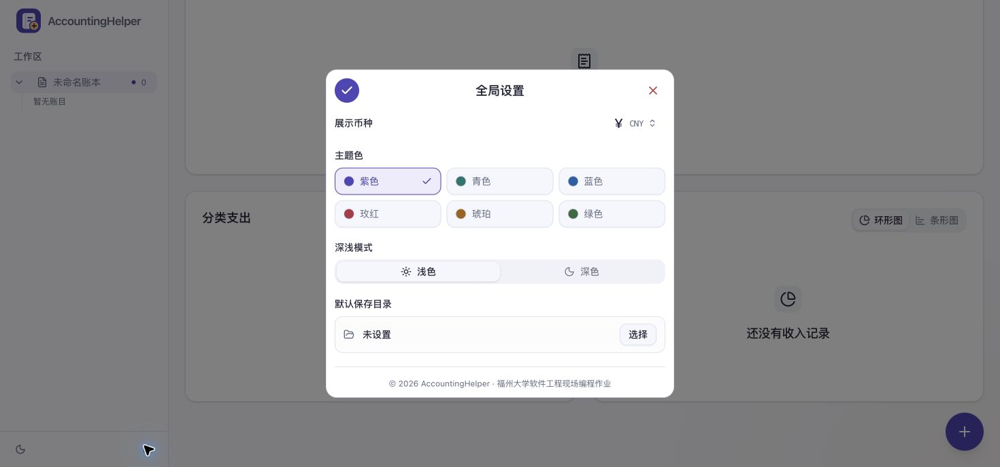
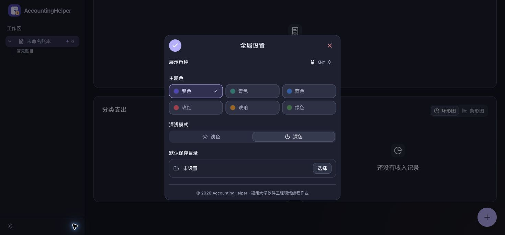

# PR #19 设置页验收

2026-11-07，按 [issue #18](https://github.com/155TuT/AccountingHelper/issues/18) 验收 [PR #19](https://github.com/155TuT/AccountingHelper/pull/19)。先在独立工作区合并组员提交，再修正问题；主工作区尚未提交的博客和截图保持原状。

## 实现与修正

- 侧栏底部右侧打开全局设置，展示币种从顶栏移入设置页；主题色独立于币种，默认紫色，提供六套深浅配色。
- 设置保存和取消沿用新建账目的图标按钮，颜色选项统一使用 shadcn Button，选中项提供边框和勾选标记。
- 每次打开初始化草稿，保存统一应用，关闭、Esc 或点击遮罩丢弃草稿。
- 默认目录仅在当前页面保留，用于首次保存与另存为。目录选择只申请读取权限，文件保存时单独授权。
- 目录选择期间禁止保存、关闭和并发文件操作；取消保持原目录，权限错误显示在设置页内，避免被遮罩挡住。
- 修正 PRD 的转义换行和架构文档表格；保留原有验收记录，新增本次记录。

## 自动化验证

- `npm test`：10 个测试文件、82 项测试通过。
- `npm run build -- --base=/AccountingHelper/`：TypeScript 与 GitHub Pages 子路径生产构建通过。
- `npm run format:check`、`git diff --check`：通过。
- 新增回归覆盖：目录选择与提交分离、取消和权限错误、操作串行、首次保存与另存为使用默认目录、清除后省略起始目录、只读权限与安全上下文检测。

目录权限失败、并发和另存为参数由模拟文件接口验证；以下流程另行使用本机 Chrome 原生文件选择器验收。

## 桌面实际操作

环境：本机桌面 Chrome、localhost，1470 × 687 页面视口。

| 场景           | 结果                                                                                                       |
| -------------- | ---------------------------------------------------------------------------------------------------------- |
| 设置入口与卡片 | 入口位于主题按钮右侧；卡片包含币种、六色、深浅模式、默认目录和版权信息，保存/关闭按钮位置正确              |
| 保存与取消     | 修改颜色和深浅模式后关闭或点击遮罩，重新打开仍为原设置；点击保存后生效                                     |
| 六套配色       | 紫色、青色、蓝色、玫红、琥珀、绿色在浅色和深色下均可保存，主色变量与页面模式正确切换                       |
| 目录选择       | 取消原生目录选择后保持设置；选择临时测试目录后，保存和关闭按钮在选择期间禁用                               |
| 真实首次保存   | 设置默认目录后新增 USD 12.34 支出，原生保存对话框从所选目录打开，成功写入独立测试文件                      |
| 币种联动       | 切换人民币后统计和表格显示 ¥87.61，文件树仍为 $12.34；磁盘 JSONL 保留 `amountCents: 1234`、`currency: USD` |
| 清除目录       | 清除并保存，重新打开设置显示“未设置”                                                                       |
| 会话与空状态   | 刷新后回到空工作台、人民币、默认紫色与系统深浅模式，目录清空；浏览器未记录警告或错误                       |

测试文件位于仓库外的临时目录；交付页面恢复空工作台。本次未在 Edge 重复原生文件选择验收。

## 界面截图

